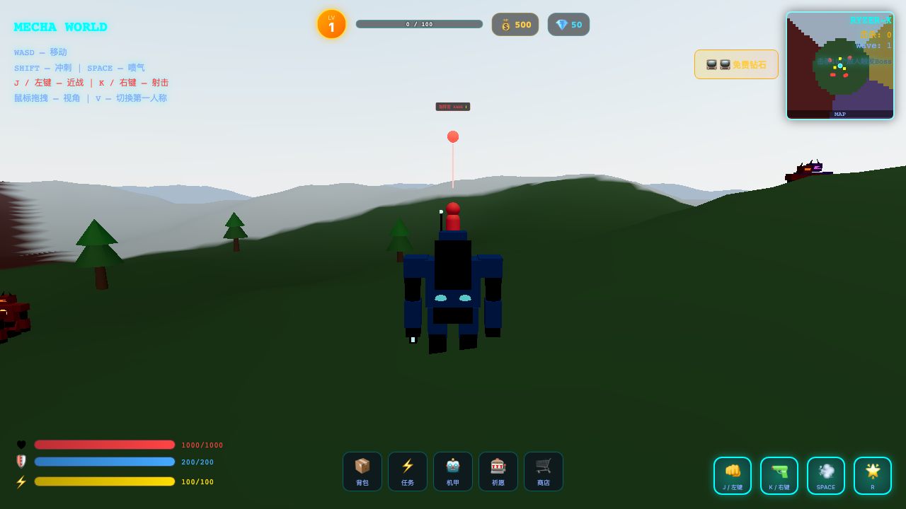
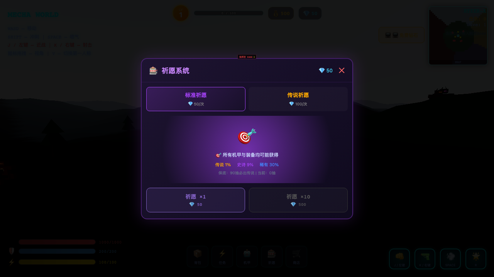
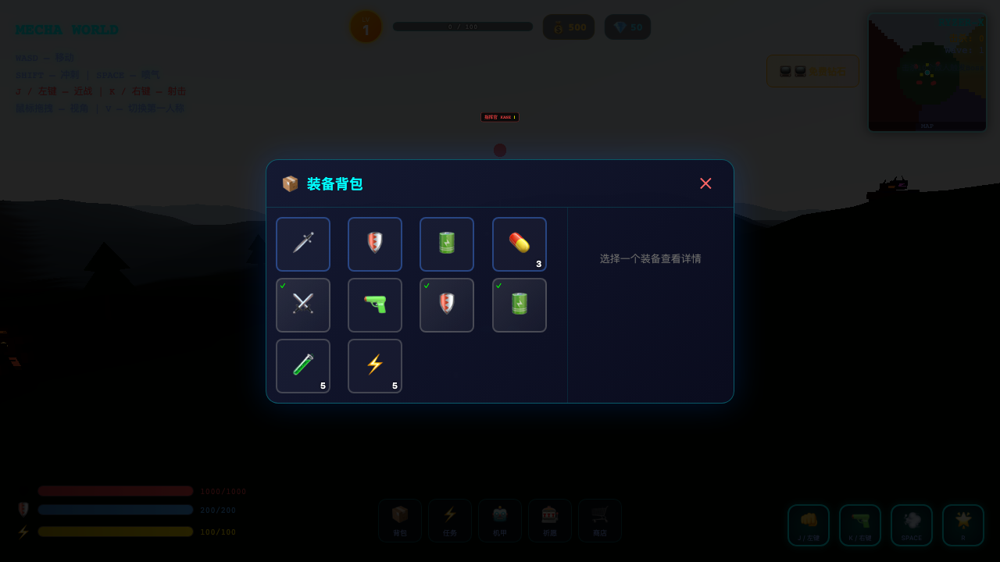
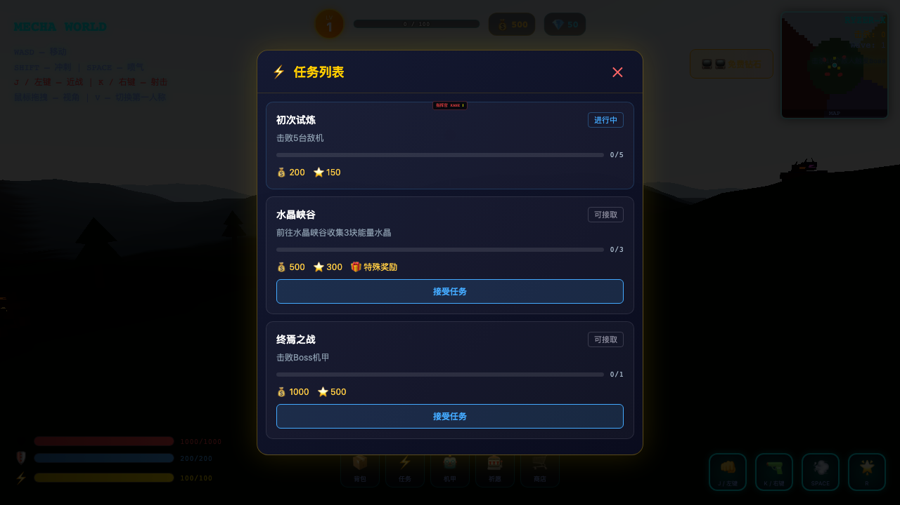

<div align="center">



# 🤖 MECHA WORLD

**A 3D open-world mecha action game that runs in your browser.**

Fight waves of enemies, explore a procedurally generated world, collect mechas through the gacha system, and unleash devastating ultimate attacks — all without downloading anything.

[](https://ytyangtao666.github.io/mecha-world/)
[](https://www.typescriptlang.org/)
[](https://react.dev/)
[](https://docs.pmnd.rs/react-three-fiber)
[](https://vite.dev/)
[](LICENSE)

</div>

---

## 📸 Screenshots

<div align="center">
<table>
<tr>
<td align="center"><b>⚔️ Open-World Combat</b></td>
<td align="center"><b>🎰 Gacha System</b></td>
</tr>
<tr>
<td></td>
<td></td>
</tr>
<tr>
<td align="center"><b>📦 Inventory & Equipment</b></td>
<td align="center"><b>📋 Quest System</b></td>
</tr>
<tr>
<td></td>
<td></td>
</tr>
</table>
</div>

---

## ✨ Features

### ⚔️ Combat System
- **Melee + Ranged** — sword slashes and energy projectiles, switch on the fly
- **Combo system** — chain attacks for bonus damage with visual counter
- **OVERDRIVE Ultimate** — charge energy, unleash screen-shaking attacks
- **Shield + HP** — layered damage mitigation
- **Critical hits** — random crits with special effects
- **Lock-on targeting** — auto-target nearest enemy

### 🌍 Open World
- **Procedural terrain** — multi-biome (plains, crystal fields, volcanic zones)
- **Dynamic day/night** — sun position and lighting shift in real-time
- **Weather system** — rain, storms, snow, sandstorms
- **Instanced props** — trees, crystals, rocks, ruins (optimized rendering)
- **Mini-map** — real-time radar
- **NPCs** — interactable characters

### 🎰 RPG Systems
- **Gacha** — pull mechas/equipment with SSR/SR/R/N rarity tiers
- **Mecha collection** — unlock and switch between multiple mechas
- **Inventory** — weapons, armor, cores with stats
- **Quests** — objectives with rewards
- **Daily login** — 7-day streak rewards
- **Shop** — spend currency on items and pulls

### 📱 Mobile-First
- **Touch controls** — dual virtual joysticks + action buttons
- **Responsive** — works portrait and landscape
- **PWA** — installable on mobile devices
- **Optimized** — instanced rendering, LOD, object pooling

---

## 🎮 Controls

| Action | Desktop | Mobile |
|--------|---------|--------|
| Move | `WASD` | Left joystick |
| Camera | Mouse drag | Right joystick |
| Melee | `J` / Left Click | Attack button |
| Shoot | `K` / Right Click | Shoot button |
| Dash | `Space` | Dash button |
| Ultimate | `R` | Ult button |
| View Toggle | `V` (FPS/TPS) | — |
| Inventory | `I` | 📦 button |
| Quests | `Q` | ⚡ button |
| Mecha Select | `M` | 🤖 button |

---

## 🚀 Quick Start

```bash
git clone https://github.com/YTyangtao666/mecha-world.git
cd mecha-world
npm install
npm run dev
```

Open http://localhost:5173

### Production Build
```bash
npm run build
npm run preview
```

---

## 🏗️ Tech Stack

| Layer | Technology | Why |
|-------|-----------|-----|
| Rendering | **Three.js** via **React Three Fiber** | Declarative 3D in React |
| Physics | **@react-three/rapier** | WASM physics, fast |
| Framework | **React 19** + **TypeScript 6** | Type-safe, modern |
| Build | **Vite 8** (Oxc) | Instant HMR |
| State | **Zustand** | Lightweight, no boilerplate |
| Lint | **Oxlint** | 50-100x faster than ESLint |

---

## 🧠 AI Backend (NEXUS)

The `apps/ai-server` package is an optional LLM backend that brings NPCs to life (GDD `mecha-world-nexus-gdd.md`). The game is **100% playable without it** — when the backend is offline, NPCs fall back to canned dialogue.

**M0–M2 complete** — monorepo, WebSocket streaming dialogue, 4 NPC personas, 4-tier memory (working/episodic/profile/world), lore RAG (hybrid vector + BM25 retrieval), and an offline eval harness.

```bash
# Zero-config (in-memory fallback, no API keys needed)
npm run dev:server          # ai-server on :8787

# Production-grade (Redis + real embedding model)
cp .env.example .env        # fill LLM_* / EMBEDDING_API_KEY
docker compose up -d redis qdrant
npm run dev:server

# Run the lore retrieval eval
npx tsx apps/ai-server/src/eval/run.ts
```

See [`docs/plans/2026-08-01-m2-memory-rag-complete.md`](docs/plans/2026-08-01-m2-memory-rag-complete.md) for the full M2 report.

---

## 📁 Project Structure

```
mecha-world/
├── src/
│   ├── combat/          # Damage, projectiles, hit detection
│   ├── controls/        # Touch input (joysticks, buttons)
│   ├── enemies/         # AI, models, spawning, rendering
│   ├── gacha/           # Gacha pulls, daily login, shop
│   ├── performance/     # LOD, culling
│   ├── rpg/             # Inventory, quests, level, mecha select
│   ├── stores/          # Zustand global state
│   ├── ui/              # Loading screen, settings
│   ├── world/           # Terrain, weather, day/night, minimap
│   ├── Game.tsx         # Main scene composition
│   ├── Player.tsx       # Player controller
│   └── MechaModel.tsx   # Player mecha 3D model
├── docs/screenshots/    # Game screenshots
└── .github/workflows/   # CI/CD (GitHub Pages deploy)
```

---

## 🎯 Design Philosophy

1. **Web-first** — No downloads. Open a URL, play immediately.
2. **Mobile-first** — Touch controls designed first, desktop enhanced.
3. **Performance** — Instanced rendering, object pooling, LOD. Target 60fps on phones.
4. **Modular** — Each system (combat, world, RPG, gacha) is self-contained.

---

## 📋 Roadmap

- [x] Player controller (move, jump, dash, fly)
- [x] Melee + ranged combat with combos
- [x] Enemy AI (patrol → chase → attack → stagger)
- [x] Boss enemies
- [x] Procedural terrain with biomes
- [x] Day/night + weather system
- [x] Gacha + inventory + quests
- [x] Touch controls
- [x] GitHub Pages deployment
- [x] **AI backend** — LLM NPC dialogue with streaming, personas, memory & lore RAG (M0-M2)
- [x] **Function calling** — 8 tools + arbiter + audit log + frontend executor (M3)
- [x] **Dynamic quests** — 5-tier validation + LLM generation + chain + confirmation UI (M4)
- [x] **AI Director** — world events + budget circuit-breaker + cost dashboard (M5)
- [x] **Content** — 50 data shards (lore RAG ×84) + canned fallback dialogue + item DB (M6)
- [ ] Polish: perf benchmarks, recording, boss arenas & audio assets (M7)
- [ ] Sound effects + music
- [ ] Unique mecha models per type
- [ ] Story mode with dungeons
- [ ] Co-op multiplayer

---

## 🤝 Contributing

See [CONTRIBUTING.md](CONTRIBUTING.md). Areas needing help:

| Area | Details |
|------|---------|
| 🎨 3D Models | Blender → glTF mechas, enemies, environment |
| 🔊 Sound | SFX, BGM tracks |
| 🗺️ Level Design | Dungeons, boss arenas |
| ⚡ Optimization | Draw call reduction, mobile perf |
| 🧪 Testing | E2E browser testing, benchmarks |

---

## 📄 License

**MIT** — see [LICENSE](LICENSE). Free for commercial use.

---

<div align="center">

**⭐ Star this repo if you like it!**

Made with 💜 by [YTyangtao666](https://github.com/YTyangtao666)

[▶ Play Now](https://ytyangtao666.github.io/mecha-world/) · [📊 Report Bug](https://github.com/YTyangtao666/mecha-world/issues) · [💡 Request Feature](https://github.com/YTyangtao666/mecha-world/issues)

</div>
