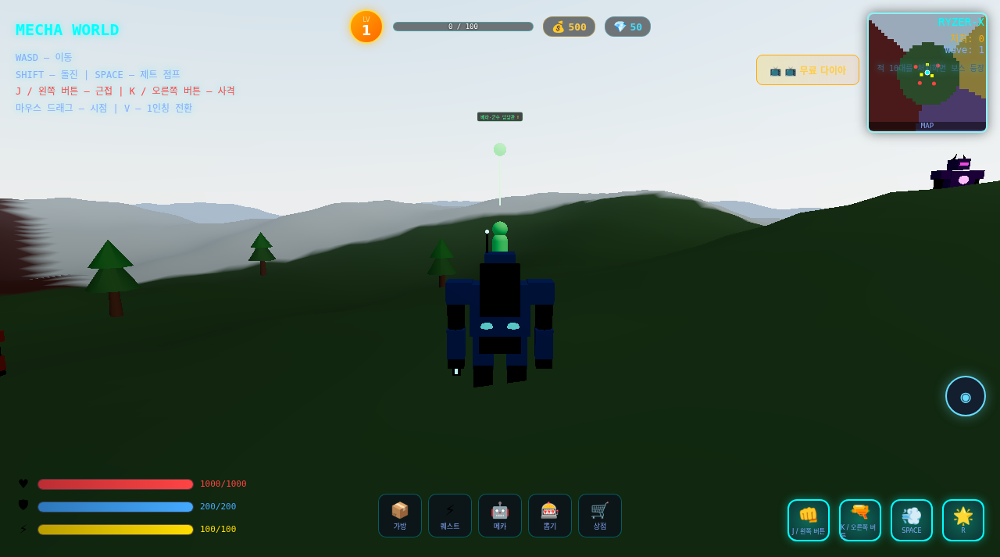

# 🤖 MECHA WORLD | 한국어 정적 체험판

[▶ 한국어판 실행](https://sigco3111.github.io/mecha-world/?v=static) · [원본 README](README.en.md)

전투·탐험·장비·메카 수집을 체험하는 3D 액션 게임입니다. 원작의 출처와 내부 식별자는 유지하고 사용자 화면을 한국어로 옮긴 포크입니다.

> **사용 전 확인:** AI 서버는 운영하지 않으며 외부 AI API를 호출하지 않습니다. 다이아는 무료 테스트 지급이고 광고는 모의 기능입니다. 실제 결제·청구나 광고 네트워크에 연결하지 않습니다.

## 실행 화면



> 한국어 정적 클라이언트의 실제 캡처입니다. AI 서버가 포함된 원작 실행과 구분됩니다.

## 주요 특징

- 근접·원거리 공격과 제트 점프
- 장비와 정적 퀘스트
- 메카 도감·장착·뽑기
- 한국어 NPC 로컬 대화

## 빠른 시작

1. 로딩 완료 대기
2. WASD로 이동
3. 마우스 드래그로 시점
4. J/K로 공격
5. 퀘스트·가방 메뉴 확인

## 기술 스택

React 19 · React Three Fiber · Three.js · TypeScript · Zustand · Vite 8 · npm workspaces

## 문서 안내

- 아래에서 상세 조작, 한글화 범위, 개발·재배포 방법과 권리 고지를 확인하세요.
- `README.en.md`는 보존된 원본 설명입니다. 원작 기능과 이 포크의 검증 범위는 다를 수 있습니다.
- `korean-localization.patch`는 번역 변경 기록입니다.

---

**YTyangtao666/mecha-world**의 React Three Fiber 기반 3D 메카 액션 게임을 한국어로 번역했습니다. 오픈월드 탐험, 근접·원거리 전투, 장비, 퀘스트, 메카 선택과 뽑기를 브라우저에서 체험할 수 있습니다.

## 시작과 조작

화면을 열면 월드가 자동으로 시작됩니다. 로딩 안내가 끝난 뒤 메카를 움직이세요.

| 기능 | 조작 |
|---|---|
| 이동 | WASD |
| 돌진 | Shift |
| 제트 점프 | Space |
| 근접 공격 | J / 왼쪽 버튼 |
| 원거리 공격 | K / 오른쪽 버튼 |
| 시점 이동 | 마우스 드래그 |
| 1인칭 전환 | V |

화면 아래 메뉴에서 가방, 퀘스트, 메카, 뽑기, 상점을 엽니다. 모바일에서는 이동 조이스틱과 스킬 버튼을 사용합니다. Echo 버튼과 NPC 대화는 한국어 로컬 대사를 보여줍니다.

## 진행

- 퀘스트 목록에서 기본 의뢰를 수락하고 보상을 받습니다.
- 적을 처치하면 경험치와 아이템을 얻을 수 있고, 10대를 처치하면 보스가 나타납니다.
- 가방에서 장비를 바꾸거나 물약을 사용합니다.
- 메카 도감에서 능력치를 비교하고 보유한 메카를 장착합니다.
- 뽑기, 출석과 상점은 게임 안의 테스트 재화로 동작합니다. 다이아 메뉴는 무료 테스트 지급이며 실제 결제·청구가 없습니다.
- 광고 보상은 원본의 모의 광고입니다. 실제 광고 네트워크에 연결하지 않습니다.

## AI 서버 제외

**이 배포는 정적 클라이언트만 제공합니다. `apps/ai-server`를 운영하지 않으며 외부 AI API를 호출하지 않습니다.** 대화창은 즉시 로컬 대화 모드로 열리고, 준비된 한국어 NPC 대사를 사용합니다. AI 생성 답변, 동적 AI 의뢰, 서버가 생성하는 월드 이벤트, 관계·AI 비용 대시보드 기능은 제공하지 않습니다. 원작 서버 소스는 참고용으로 포크에 남아 있으나 Pages 실행과 무관합니다.

기본 전투·탐험·정적 퀘스트·장비·뽑기는 유지합니다. 로컬 대화는 실제 수리나 거래를 수행하지 않으며 해당 메뉴를 안내합니다.

## 번역과 배포

중국어 HUD, 조작 안내, 퀘스트, 장비·메카 이름과 설명, 메뉴, 설정, 출석, 모의 광고, 뽑기, 상점과 NPC 대사를 한국어로 바꿨습니다. 내부 ID와 원작자 표시는 유지했습니다. 원본 README는 `README.en.md`, 변경 기록은 `korean-localization.patch`에 있습니다.

GitHub Pages 루트는 사전 빌드된 `7-ko.html`을 iframe으로 열며 게임 번들은 HTML 안에 포함됩니다. 원작은 React 19, TypeScript, Vite 8, Three.js와 Zustand를 사용합니다. 서버 프로세스는 필요하지 않습니다.

## 개발과 재빌드

```bash
npm ci
VITE_BASE_PATH=/mecha-world/ npm run build
npm run dev
```

루트 빌드는 shared 패키지와 game 클라이언트를 빌드합니다. AI 서버를 빌드하거나 실행하지 않습니다. Vite의 `/mecha-world/` 기본 경로를 지정해 Pages 경로에서 자산이 맞게 로드되도록 합니다. 재배포 시 `apps/game/dist`의 파일을 Pages 정적 경로에 넣거나 `node build-pages.mjs`로 단일 HTML을 생성하세요. 생성된 `ko.html`을 배포한 뒤 루트 launcher의 파일명도 맞추세요.

## 원작과 라이선스

원작: **YTyangtao666** 및 원본 기여자

원본 저장소: https://github.com/YTyangtao666/mecha-world

한글화·정적 배포: **sigco3111** 포크

원본 MIT `LICENSE`를 그대로 보존했습니다. 저사양 기기에서는 3D 월드 생성·렌더링이 느릴 수 있습니다. 브라우저 저장소를 지우면 로컬 진행 상황도 사라질 수 있습니다. 이 프로젝트는 개발 중인 체험판이므로 모든 퀘스트와 지형이 완성된 게임처럼 동작한다고 보장하지 않습니다.
